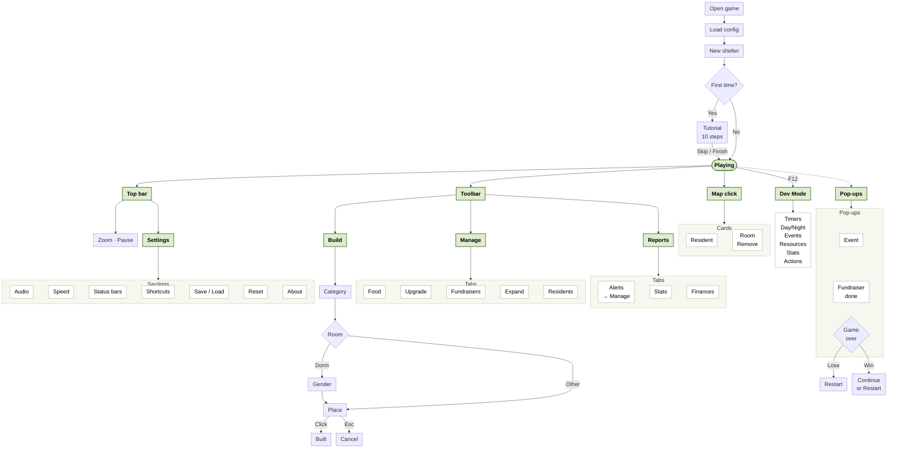

# Open Arms — Game Start and Menus

Dotted arrow: opens by itself. Save, Load and Reset ask to confirm.

| Key | Does |
|---|---|
| Space | Pause |
| S | Save |
| B | Status bars |
| Esc | Close / cancel |
| F12 | Dev Mode |
