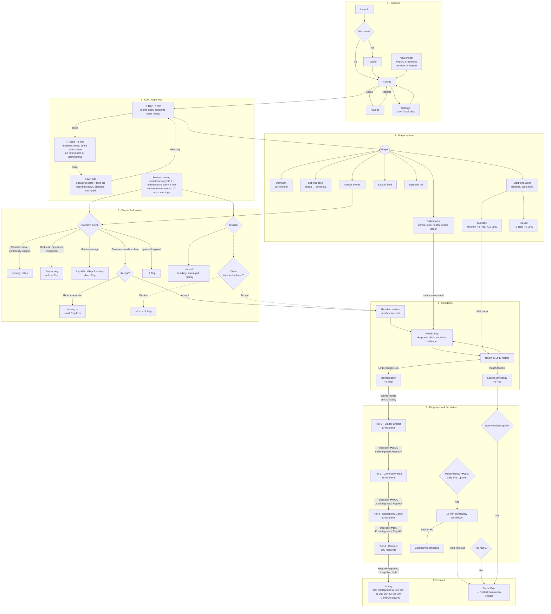
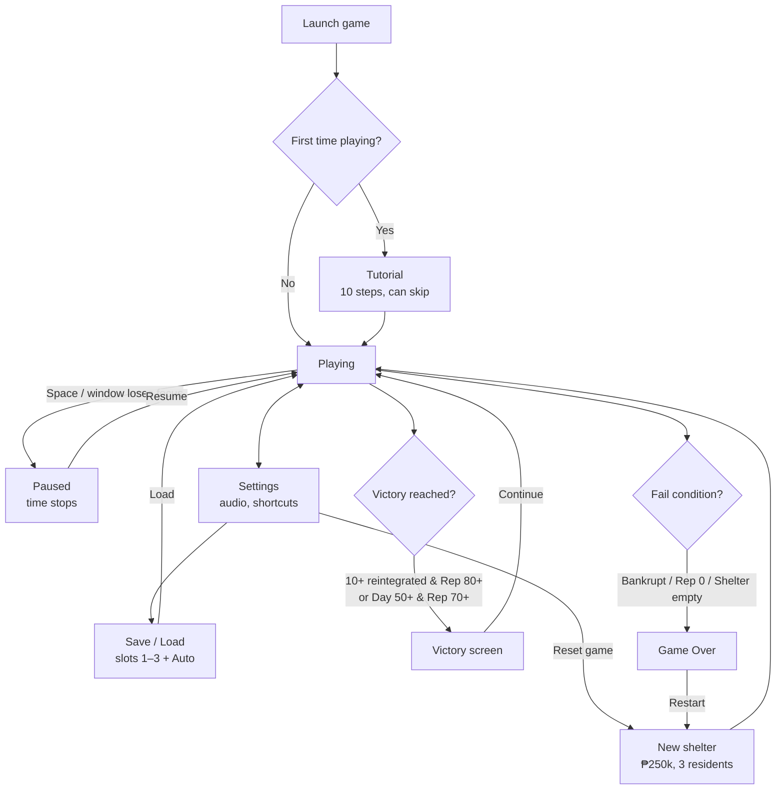
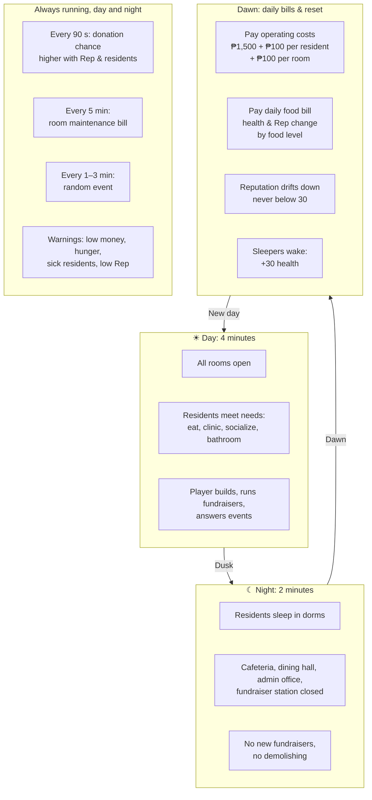
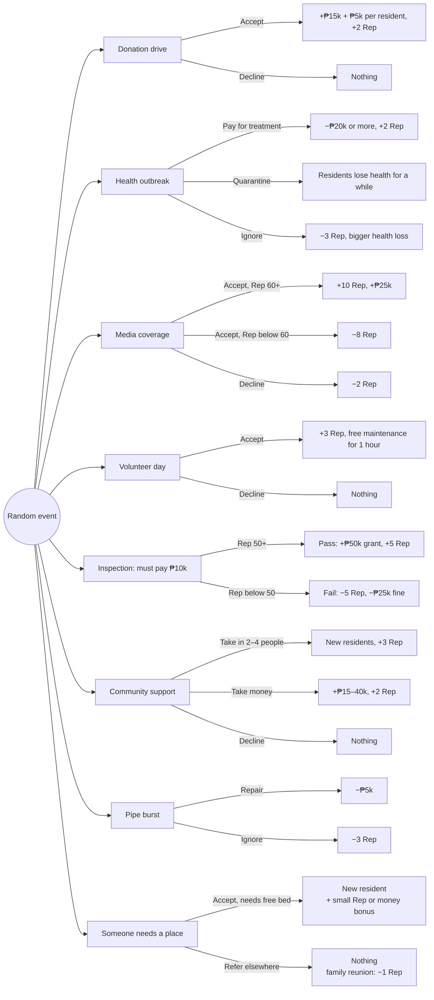
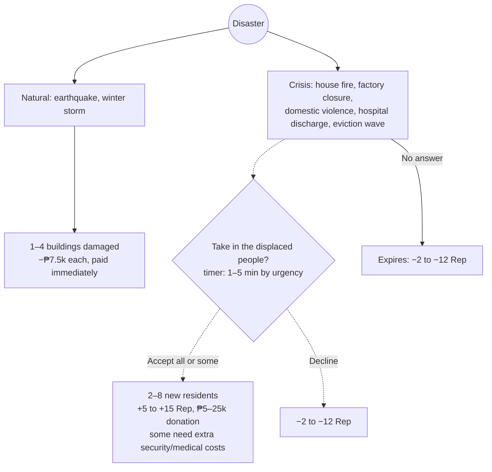
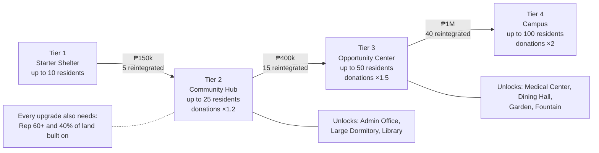
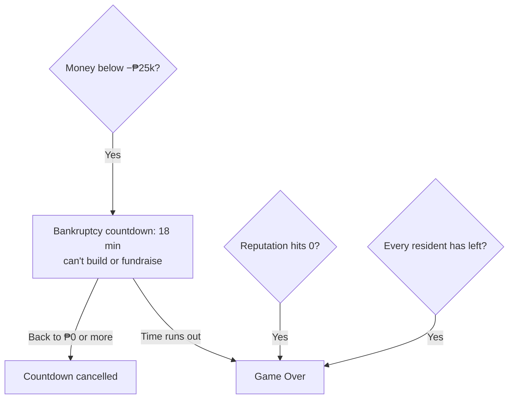

# Open Arms — Game Flow

Open Arms is a shelter-management game. You build and run a shelter, take in people in need, keep them healthy, and help them rebuild their lives until they are ready to leave: **reintegration**. Money and reputation are the two resources that keep the shelter alive.

The diagrams below go from the big picture down to the details:

1. [Session flow](#1-session-flow)
2. [Core loop: day and night](#2-core-loop-day-and-night)
3. [Player actions and outcomes](#3-player-actions-and-outcomes)
4. [Resident lifecycle](#4-resident-lifecycle)
5. [Events and choices](#5-events-and-choices)
6. [Progression and fail states](#6-progression-and-fail-states)

**Legend:** solid arrows are working gameplay. Dashed arrows (`-.->`) are designed features that are not yet wired into the game (see [Not yet wired in](#not-yet-wired-in)). Money is in pesos (₱). "Rep" means reputation (0–100).

---

## The whole game at a glance

All six charts below, combined into one diagram. Each numbered box is a condensed version of its section. The arrows between boxes show how the parts of the game feed each other.

---

## 1. Session flow

The game autosaves on its own. Victory does not end the run: the player can keep playing. Game over can only be followed by a restart.

---

## 2. Core loop: day and night

One in-game day lasts 6 minutes. Money comes in from donations, fundraisers and events. It goes out every dawn and every maintenance cycle. The core tension is keeping that balance positive while still growing.

---

## 3. Player actions and outcomes

```mermaid
flowchart TD
    P(("Player")) --> Build["Build menu"]
    P --> Manage["Manage menu"]
    P --> Reports["Reports menu"]
    P --> Inspect["Click a resident<br/>view health, LIFE, energy"]

    %% ---------- BUILD ----------
    Build --> Place["Place a room<br/>pay build cost"]
    Place --> Essentials["Essentials: Dormitory, Cafeteria, Bathroom<br/>beds, food, hygiene"]
    Place --> Health["Health: Clinic → Medical Center<br/>restores health"]
    Place --> Social["Social: Common Room, Library, Garden<br/>health + faster LIFE growth"]
    Place --> Mgmt["Management: Fundraiser Station, Admin Office<br/>enables fundraisers"]
    Place --> Decor["Decor: Potted Plant, Fountain<br/>bonus to neighboring rooms"]
    Place --> Adj["Room placement matters:<br/>neighbors give bonuses or penalties"]
    Place --> Upkeep["Every room adds to<br/>maintenance & daily costs"]
    Build --> Demolish["Demolish a room<br/>refund 20% of cost"]

    %% ---------- MANAGE ----------
    Manage --> Tier["Upgrade shelter tier"]
    Tier --> TierOut["Higher resident cap,<br/>bigger donations, new rooms"]

    Manage --> FoodLvl["Set food level<br/>5 levels"]
    FoodLvl --> FoodLow["Cheap food: save money<br/>lose health & Rep daily"]
    FoodLvl --> FoodHigh["Generous food: costs more<br/>gain health & Rep daily"]

    Manage --> Fund["Start fundraiser<br/>daytime only, costs food"]
    Fund --> Team["1–3 rested residents go out<br/>healthier team = better odds"]
    Team --> FundWin["Success<br/>+money, +2 Rep, +15 LIFE"]
    Team --> FundFail["Failure<br/>−2 Rep, +5 LIFE"]
    FundWin --> Tired["Team loses health<br/>and must rest"]
    FundFail --> Tired
    Fund --> Cancel["Cancel: food is not refunded"]

    Manage --> Expand["Expand land north / east / west<br/>gets pricier each time"]
    Manage --> Roster["Resident list"]

    %% ---------- REPORTS ----------
    Reports --> Alerts["Alerts: warnings with fixes"]
    Reports --> Stats["Statistics"]
    Reports --> Fin["Finances dashboard"]
```

Most decisions trade money now against reputation, health or growth later. Fundraisers are the main way to raise a resident's LIFE meter, which means they drive reintegration. They cost food and wear residents out.

---

## 4. Resident lifecycle

```mermaid
flowchart TD
    Event["Player accepts an arrival event"] --> Bed{"Free bed of matching gender<br/>and under the tier cap?"}
    Bed -- No --> Refused["Can't accept"]
    Bed -- Yes --> Arrive["Resident arrives<br/>70 health, low LIFE<br/>young adult / adult / elderly"]

    Arrive --> Needs{"What do they need now?"}
    Needs -- "Night" --> Sleep["Sleep in dorm<br/>+health"]
    Needs -- "Hungry" --> Eat{"Food in stock?"}
    Eat -- Yes --> Ate["Eat: uses 3 food"]
    Eat -- No --> Hungry["Leaves hungry"]
    Needs -- "Health below 35" --> Clinic["Clinic<br/>+health"]
    Needs -- "Health below 60" --> Socialize["Common Room / Library / Garden<br/>+health"]
    Needs -- "Random" --> Bath["Bathroom"]
    Needs -- "Nothing urgent" --> Stroll["Wander"]
    Sleep & Ate & Hungry & Clinic & Socialize & Bath & Stroll --> Meters

    Meters["Health decays daily<br/>elderly fastest<br/>LIFE grows slowly"] --> Fundraise["Joins fundraisers<br/>big LIFE boost"]
    Fundraise --> Meters
    Meters --> Needs

    Meters -- "LIFE reaches 100" --> Reintegrated["Reintegration<br/>resident leaves ready for life outside<br/>+5 Rep"]
    Meters -- "Health below 20 for too long<br/>or health hits 0" --> LeftSick["Leaves unhealthy<br/>−3 Rep"]
```

Each resident has two meters. **Health** keeps them in the shelter. **LIFE** measures their readiness for life outside, and reintegration happens when it fills. The player's job is to keep health up long enough for LIFE to fill.

---

## 5. Events and choices

Random events arrive every 1–3 minutes, with at most 3 waiting at once. Each one must be answered within 5 minutes. **Ignoring an event or letting it expire costs −2 Rep.**

### 5a. Random events

Arrival events include an elder transfer, a job referral, a knock at the door, street outreach, a hospital referral and a family reunification. Accepting them is the **only way new residents join** the shelter.

### 5b. Disasters

About every 5 minutes, a disaster may strike the community.

Bigger crises bring more people and more reputation, and they cost more to turn away. Today the decision window is not shown, so every crisis expires and costs its decline penalty (dashed lines).

---

## 6. Progression and fail states

**Ways to win:** reintegrate 10+ residents with Rep 80+, *or* survive 50+ days with Rep 70+.

**Ways to lose:** bankruptcy, reputation collapse, or an empty shelter.

---

## Not yet wired in

These features are designed and partly built, but do not affect play yet:

- **Disaster decision window.** Crisis disasters can't be accepted or declined yet. They always expire with the decline penalty, and their displaced residents never arrive.
- **Lasting event effects.** The health loss from quarantine or ignoring an outbreak, and volunteer day's free maintenance, are recorded but never applied. Only the reputation and money changes take effect.
- **Tier upgrades enlarging the land.** Upgrading raises the resident cap and donations but doesn't enlarge the buildable area. Land grows only through Expand.
- **Game speed setting.** Present in Settings, but has no effect.
