# Open Arms — Game Flow (horizontal layout)

All six game flow charts in one landscape diagram, laid out to fit a document page. For the full version with notes, see [GAME_FLOW.md](GAME_FLOW.md).

**Legend:** dashed arrows are designed features that are not yet wired into the game. Money is in pesos (₱). "Rep" means reputation (0–100).

```mermaid
flowchart TB
    %% ========== 1 · SESSION ==========
    subgraph G1["1 · Session flow"]
        direction LR
        a1["Launch game"] --> a2{"First time<br/>playing?"}
        a2 -- Yes --> a3["Tutorial<br/>10 steps, can skip"]
        a2 -- No --> a4
        a3 --> a4["Playing"]
        a4 -- "Space /<br/>focus lost" --> a5["Paused"]
        a5 -- Resume --> a4
        a4 --> a6["Settings<br/>audio, shortcuts"]
        a6 --> a7["Save / Load<br/>slots 1–3 + Auto"]
        a7 -- Load --> a4
        a6 -- "Reset game" --> a8["New shelter<br/>₱250k, 3 residents"]
        a8 --> a4
        a4 --> a9{"Victory?"}
        a9 -- "10+ reintegrated & Rep 80+<br/>or Day 50+ & Rep 70+" --> a10["Victory screen"]
        a10 -- Continue --> a4
        a4 --> a11{"Fail condition?"}
        a11 -- "Bankrupt / Rep 0 /<br/>shelter empty" --> a12["Game Over"]
        a12 -- Restart --> a8
    end

    %% ========== 2 · DAY / NIGHT ==========
    subgraph G2["2 · Core loop: day & night · ↻ after Dawn a new Day begins"]
        direction LR
        subgraph b_day["☀ Day · 4 min"]
            direction TB
            b1["All rooms open"]
            b2["Residents meet needs:<br/>eat, clinic, socialize, bathroom"]
            b3["Player builds, fundraises,<br/>answers events"]
        end
        subgraph b_night["☾ Night · 2 min"]
            direction TB
            b4["Residents sleep<br/>in dorms"]
            b5["Cafeteria, dining hall, admin,<br/>fundraiser station closed"]
            b6["No fundraisers,<br/>no demolishing"]
        end
        subgraph b_dawn["Dawn · daily bills & reset"]
            direction TB
            b7["Operating costs<br/>₱1,500 + ₱100/resident<br/>+ ₱100/room"]
            b8["Food bill<br/>health & Rep change<br/>by food level"]
            b9["Rep drifts down<br/>never below 30"]
            b10["Sleepers wake<br/>+30 health"]
        end
        subgraph b_bg["Always running"]
            direction TB
            b11["Donation chance<br/>every 90 s"]
            b12["Maintenance bill<br/>every 5 min"]
            b13["Random event<br/>every 1–3 min"]
            b14["Warnings: money,<br/>hunger, health, Rep"]
        end
        b_day -- Dusk --> b_night
        b_night -- Dawn --> b_dawn
        b_dawn ~~~ b_bg
    end

    %% ========== 3 · PLAYER ACTIONS ==========
    subgraph G3["3 · Player actions → outcomes"]
        direction TB
        c0(("Player"))
        c0 --> c1["Build"]
        c0 --> c2["Manage"]
        c0 --> c3["Reports<br/>alerts, statistics,<br/>finances"]
        c0 --> c4["Click resident<br/>view health, LIFE, energy"]
        c1 --> c5["Place room<br/>pay build cost"]
        c1 --> c6["Demolish<br/>20% refund"]
        c5 --> c7["Essentials: Dormitory,<br/>Cafeteria, Bathroom<br/>Health: Clinic → Medical Center<br/>Social: Common Room,<br/>Library, Garden<br/>Management: Fundraiser<br/>Station, Admin Office<br/>Decor: Plant, Fountain"]
        c5 --> c12["Neighbors give<br/>bonuses / penalties<br/>every room adds upkeep"]
        c2 --> c13["Upgrade tier"]
        c13 --> c14["Higher cap, bigger<br/>donations, new rooms"]
        c2 --> c15["Food level · 5 levels"]
        c15 --> c16["Cheap: save money,<br/>lose health & Rep daily"]
        c15 --> c17["Generous: costs more,<br/>gain health & Rep daily"]
        c2 --> c18["Start fundraiser<br/>daytime only, costs food"]
        c18 --> c19["1–3 rested residents<br/>healthier = better odds"]
        c19 --> c20["Success<br/>+money, +2 Rep, +15 LIFE"]
        c19 --> c21["Failure<br/>−2 Rep, +5 LIFE"]
        c20 --> c22["Team loses health,<br/>must rest"]
        c21 --> c22
        c18 --> c23["Cancel<br/>food not refunded"]
        c2 --> c24["Expand land N / E / W<br/>pricier each time"]
    end

    %% ========== 4 · RESIDENT LIFECYCLE ==========
    subgraph G4["4 · Resident lifecycle"]
        direction LR
        d1["Player accepts<br/>arrival event"] --> d2{"Free bed &<br/>under tier cap?"}
        d2 -- No --> d3["Can't accept"]
        d2 -- Yes --> d4["Resident arrives<br/>70 health, low LIFE"]
        d4 --> d5{"Current need?"}
        d5 -- Night --> d6["Sleep: +health"]
        d5 -- Hungry --> d7{"Food in<br/>stock?"}
        d7 -- Yes --> d8["Eat: uses 3 food"]
        d7 -- No --> d9["Leaves hungry"]
        d5 -- "Health below 35" --> d10["Clinic: +health"]
        d5 -- "Health below 60" --> d11["Socialize: +health"]
        d5 -- Random --> d12["Bathroom"]
        d5 -- "Nothing urgent" --> d13["Wander"]
        d6 & d8 & d9 & d10 & d11 & d12 & d13 --> d14["Health decays daily<br/>LIFE grows slowly"]
        d14 --> d15["Fundraisers<br/>big LIFE boost"]
        d15 --> d14
        d14 -- "LIFE reaches 100" --> d16["Reintegration<br/>+5 Rep"]
        d14 -- "Health below 20 too long<br/>or hits 0" --> d17["Leaves unhealthy<br/>−3 Rep"]
    end

    %% ========== 5 · EVENTS ==========
    subgraph G5["5 · Events & choices · random event every 1–3 min · ignored or expired = −2 Rep"]
        direction TB
        subgraph ev1["Donation drive"]
            direction LR
            e1(("Donation<br/>drive"))
            e1 -- Accept --> e2["+₱15k + ₱5k/resident<br/>+2 Rep"]
            e1 -- Decline --> e3["Nothing"]
        end
        subgraph ev2["Health outbreak"]
            direction LR
            e4(("Health<br/>outbreak"))
            e4 -- "Pay treatment" --> e5["−₱20k or more<br/>+2 Rep"]
            e4 -- Quarantine --> e6["Health loss<br/>for a while"]
            e4 -- Ignore --> e7["−3 Rep<br/>bigger health loss"]
        end
        subgraph ev3["Media coverage"]
            direction LR
            e8(("Media<br/>coverage"))
            e8 -- "Accept, Rep 60+" --> e9["+10 Rep, +₱25k"]
            e8 -- "Accept, Rep below 60" --> e10["−8 Rep"]
            e8 -- Decline --> e11["−2 Rep"]
        end
        subgraph ev4["Volunteer day"]
            direction LR
            e12(("Volunteer<br/>day"))
            e12 -- Accept --> e13["+3 Rep<br/>free maintenance 1 h"]
            e12 -- Decline --> e14["Nothing"]
        end
        subgraph ev5["Inspection · must pay ₱10k"]
            direction LR
            e15(("Inspection"))
            e15 -- "Rep 50+" --> e16["Pass: +₱50k, +5 Rep"]
            e15 -- "Rep below 50" --> e17["Fail: −5 Rep, −₱25k"]
        end
        subgraph ev6["Community support"]
            direction LR
            e18(("Community<br/>support"))
            e18 -- "Take 2–4 people" --> e19["New residents, +3 Rep"]
            e18 -- "Take money" --> e20["+₱15–40k, +2 Rep"]
            e18 -- Decline --> e21["Nothing"]
        end
        subgraph ev7["Pipe burst"]
            direction LR
            e22(("Pipe<br/>burst"))
            e22 -- Repair --> e23["−₱5k"]
            e22 -- Ignore --> e24["−3 Rep"]
        end
        subgraph ev8["Someone needs a place"]
            direction LR
            e25(("Arrival"))
            e25 -- "Accept, needs bed" --> e26["New resident<br/>+ small Rep or ₱ bonus"]
            e25 -- "Refer elsewhere" --> e27["Nothing<br/>family reunion: −1 Rep"]
        end
        subgraph ev9["Disasters · about every 5 min"]
            direction LR
            e30(("Disaster"))
            e30 --> e31["Natural: earthquake,<br/>winter storm"]
            e31 --> e32["1–4 buildings damaged<br/>−₱7.5k each"]
            e30 --> e33["Crisis: fire, factory closure,<br/>violence, discharge, eviction"]
            e33 -.-> e34{"Take in<br/>displaced?"}
            e34 -.->|"Accept"| e35["2–8 new residents<br/>+5 to +15 Rep, ₱5–25k"]
            e34 -.->|"Decline"| e36["−2 to −12 Rep"]
            e33 -- "No answer" --> e37["Expires<br/>−2 to −12 Rep"]
        end
        ev1 ~~~ ev4
        ev2 ~~~ ev5
        ev3 ~~~ ev6
        ev4 ~~~ ev7
        ev5 ~~~ ev8
        ev6 ~~~ ev9
    end

    %% ========== 6 · PROGRESSION & FAIL ==========
    subgraph G6["6 · Progression & fail states"]
        direction TB
        subgraph f_tiers["Tier ladder · every upgrade also needs Rep 60+ & 40% of land built"]
            direction LR
            f1["Tier 1 · Starter Shelter<br/>up to 10 residents"]
            f2["Tier 2 · Community Hub<br/>25 residents · donations ×1.2<br/>unlocks Admin Office,<br/>Large Dormitory, Library"]
            f3["Tier 3 · Opportunity Center<br/>50 residents · donations ×1.5<br/>unlocks Medical Center,<br/>Dining Hall, Garden, Fountain"]
            f4["Tier 4 · Campus<br/>100 residents · donations ×2"]
            f1 -- "₱150k ·<br/>5 reintegrated" --> f2
            f2 -- "₱400k ·<br/>15 reintegrated" --> f3
            f3 -- "₱1M ·<br/>40 reintegrated" --> f4
        end
        subgraph f_fail["Ways to lose"]
            direction LR
            f5{"Money below<br/>−₱25k?"} -- Yes --> f6["Bankruptcy countdown<br/>18 min · can't build<br/>or fundraise"]
            f6 -- "Back to ₱0" --> f7["Countdown cancelled"]
            f6 -- "Time runs out" --> f8["Game Over"]
            f9{"Rep hits 0?"} -- Yes --> f8
            f10{"Every resident<br/>left?"} -- Yes --> f8
        end
        f_tiers ~~~ f_fail
    end

    %% ========== PAGE LAYOUT (invisible links): 2 columns × 3 rows ==========
    G1 ~~~ G3
    G3 ~~~ G5
    G2 ~~~ G4
    G4 ~~~ G6
```

