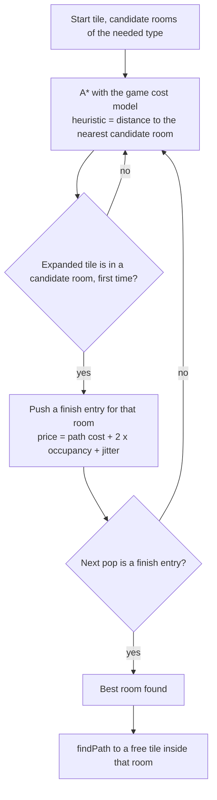

# CareRoute Benchmark: Open Arms pathfinding vs BFS vs textbook A*

Run: 2026-11-23 · Node v22.23.3, linux/x64 · Script: [scripts/pathfinding-bench.ts](../scripts/pathfinding-bench.ts) · Raw output: [PATHFINDING_BENCHMARK_RAW.md](PATHFINDING_BENCHMARK_RAW.md)

---

## 1. Summary

CareRoute is the movement engine in [PathfindingSystem.ts](../src/game/systems/PathfindingSystem.ts). It is A\* with shelter-specific step costs, on a binary heap with typed arrays, plus a one-search room choice. Both parts are **shipped in `src`** and are what this benchmark measures.

| Question | Answer |
|:--|:--|
| Do we need the shelter cost model, or would plain A\*/BFS do? | We need it. Plain A\* and BFS produce routes that cost **29-62% more** in game terms on shelter maps, cross about **6 room tiles per trip** where CareRoute crosses about **0.4**, and with 80 residents present walk through occupied tiles about **1.9 times per trip** where CareRoute does about **0.1**. |
| Is CareRoute slower than textbook A\*? | Yes, 2-11x slower on shelter maps (about 2x at tier 1, 4x at tier 4, 11x with 80 residents), because it works harder to avoid rooms and crowds. In absolute terms a search is 2-22 µs on a shelter grid. |
| How good are its paths under its own costs? | Within 0.4% of the best path on shelter maps (mean overhead 0.30-0.37%); the best path in 79-89% of queries. |
| How much faster is it than the code it replaced? | `findPath`: **2.6x** at tier 4 (22.9 → 8.7 µs), 1.7x with 80 residents, **3.4x** geometric mean over all 13 maps, 61x on a 160x120 map. Paths are the same to within 0.1%. |
| How does it compare with other algorithms? | Among the algorithms whose routes stay within 0.4% of the best, it is the fastest. Faster ones (textbook A\*, greedy, bidirectional BFS, weighted A\*) cross about 4-15x more room tiles or collide about 3-19x more; the one other algorithm with equal route quality (Dijkstra) does 4.8x the work. See section 5.7. |
| What about room choice (CareRoute Match)? | **3.6x faster at tier 4** (131 → 36 µs), 3.2x with 30 residents. Slightly slower at tier 2 (0.87x). It picks the best room as often or more often: 95% vs 94% at tier 4, **93% vs 83%** with 30 residents, 98% vs 89% at tier 2. |

**What the speedup is and is not.** On shelter maps the new `findPath` expands 86-97% of the nodes the old one did. It is faster because of the data structures (heap, typed arrays), not because it searches much less. The routes are the same quality.

---

## 2. What was compared

Path search:

| Label | What it is |
|:--|:--|
| **BFS** | Breadth-first search, unit step cost, no heuristic. |
| **A\* textbook** | A\* with Manhattan heuristic and unit step cost, binary heap. |
| **Previous findPath** | The pre-CareRoute code, preserved as an instrumented copy in the benchmark: same cost model, linear-scan open list, object nodes, `Map`/`Set`. |
| **CareRoute findPath** | The shipped `findPath`: same cost model, binary heap, typed arrays. |
| **Exact turns** | CareRoute plus the arrival direction in the search state, so the turn penalty is exactly optimal. Not adopted (section 5.5). |
| **Dijkstra** | Same shelter costs, no heuristic: expands in order of cost so far. Optimal per tile; the quality reference. |
| **Weighted A\* (w=2)** | Same shelter costs, heuristic doubled: explores less, may return a costlier route (bounded at 2x). |
| **Greedy best-first** | Orders by the heuristic alone and ignores cost so far. Fast, no optimality. |
| **Bidirectional BFS** | Unit cost; floods from start and goal at once and stops when the floods meet. |

Room choice:

| Label | What it is |
|:--|:--|
| **Previous findNearestRoom** | One linear-scan A\* per open room of the type, to a random free tile, scored by steps + 2 x occupancy + jitter 0-4. |
| **BFS flood** | One flood from the start until any candidate room is reached. Nearest by steps; ignores crowds. |
| **CareRoute Match** | The shipped `findNearestRoom`. One multi-goal search chooses the room, then one `findPath` to a free tile inside it. Shown with the game's jitter (0-4) and without. |

---

## 3. The algorithm

### 3.1 Cost model

Every step costs 1 plus the following ([findPath](../src/game/systems/PathfindingSystem.ts)):

| Situation | Extra cost | Effect |
|:--|--:|:--|
| Changing direction | +0.3 | Straight runs over zig-zags |
| Tile of a room that is neither the start nor goal room | +2 | Open floor over cutting through rooms |
| Tile held by another resident (not the goal tile) | +4 | Bend around crowds |
| Same, with `hardBlock` | impassable | Re-route after getting stuck |

Heuristic: Manhattan distance. Every step costs at least 1, so it never overestimates. **Known limit:** nodes are tracked per tile, not per (tile, direction), so the turn penalty is approximate. Measured loss: 0.30-0.37% of path cost on shelter maps (section 5.3).

### 3.2 CareRoute Match (one search for room choice)



- Entering a room you are heading for is not a detour, so the +2 and +4 charged on its entry tile are refunded in its finish price.
- Jitter (0-4, random per room per call) is the game's existing way to spread residents over rooms; it is kept.
- **Known limit:** the refund means the heuristic can overestimate by up to 6 on the entry tile, so the pick can be marginally off. Measured regret: 0.02-0.09 cost units (section 6.5).

---

## 4. Method

**Maps (13).** Real game grids at tiers 1-4 (12x12 to 26x26 unlocked in the 40x30 grid, 7 to 39 rooms, built with the real `initializeGrid` and `placeRoom`); tier 4 with 30 and with 80 static residents; empty 40x30 and 160x120; 25% obstacles at both sizes; braided mazes 41x31 and 121x91; a goal sealed behind a wall.

**Queries.** Seeded random start/goal pairs from the largest connected region: 200 per game-sized map, 60 per 160x120 map, 80 per room-choice scenario.

**Metrics.** Speed (median and p95 µs per query over 21 timed passes, 9 on large maps; interleaved, `gc()` before each batch, warm-up discarded); work (nodes expanded, discovered, peak frontier); path quality (every path re-scored with the game cost model against the best found by any method on that query).

**Room-choice score.** Each candidate room has a best price: the minimum over all its tiles of (exact path cost + 2 x occupancy). A method is scored on the room it chose, so the random tile it walks to inside the room does not count. "Best room" = the chosen room has the lowest best price; regret = chosen price minus lowest price.

**Integrity checks, run on every benchmark run (a failure makes `npm run bench:path` exit non-zero):**
- The shipped `findPath` returns the same path as its instrumented mirror on every query: 0 mismatches on all 13 maps.
- Exact-turn search is optimal under the game costs on every query of the 12 maps with paths.
- Every room result ends on a tile inside the room it names (all 3 room scenarios).

---

## 5. Path search results

### 5.1 Speed relative to the previous `findPath` (median, higher is faster)

| Map | BFS | A\* textbook | Previous | **CareRoute** | Exact turns |
|:--|--:|--:|--:|--:|--:|
| shelter T1 | 2.01x | 5.37x | 1.00x | **2.86x** | 1.59x |
| shelter T2 | 2.08x | 7.40x | 1.00x | **2.81x** | 1.35x |
| shelter T3 | 2.34x | 9.95x | 1.00x | **2.72x** | 1.18x |
| shelter T4 | 2.11x | 11.07x | 1.00x | **2.61x** | 1.16x |
| shelter T4, 30 residents | 3.18x | 14.88x | 1.00x | **1.71x** | 0.76x |
| shelter T4, 80 residents | 3.90x | 19.01x | 1.00x | **1.72x** | 0.70x |
| open 40x30 | 1.44x | 9.23x | 1.00x | **7.58x** | 4.80x |
| open 160x120 | 3.05x | 75.61x | 1.00x | **61.03x** | 37.55x |
| obstacles 40x30 | 1.46x | 3.38x | 1.00x | **2.36x** | 0.98x |
| obstacles 160x120 | 1.71x | 6.68x | 1.00x | **3.44x** | 1.21x |
| maze 41x31 | 2.54x | 2.56x | 1.00x | **2.46x** | 0.91x |
| maze 121x91 | 2.10x | 2.76x | 1.00x | **2.47x** | 0.97x |
| unreachable goal | 8.67x | 3.04x | 1.00x | **2.33x** | 0.58x |
| **geometric mean** | 2.47x | 7.84x | 1.00x | **3.43x** | 1.48x |

Absolute time per search, previous → CareRoute: shelter T1 5.7 → 2.0 µs · T4 22.9 → 8.7 µs · T4 with 80 residents 39.1 → 22.7 µs · maze 121x91 309 → 125 µs · open 160x120 1240 → 20 µs. At game scale every search is tens of microseconds.

### 5.2 Work, independent of hardware

Nodes expanded relative to the previous `findPath`:

| Map | BFS | A\* textbook | **CareRoute** | Exact turns |
|:--|--:|--:|--:|--:|
| shelter T1 | 3.27 | 0.47 | **0.86** | 1.22 |
| shelter T2 | 4.08 | 0.37 | **0.86** | 1.44 |
| shelter T3 | 3.92 | 0.28 | **0.91** | 1.78 |
| shelter T4 | 4.63 | 0.26 | **0.95** | 1.85 |
| shelter T4, 30 residents | 4.62 | 0.27 | **0.95** | 1.93 |
| shelter T4, 80 residents | 3.82 | 0.23 | **0.97** | 2.19 |
| open 40x30 | 8.00 | 0.33 | **0.43** | 0.43 |
| open 160x120 | 15.75 | 0.16 | **0.21** | 0.21 |
| obstacles 40x30 | 3.78 | 0.64 | **0.98** | 2.02 |
| obstacles 160x120 | 4.77 | 0.52 | **0.99** | 2.64 |
| maze 41x31 | 1.61 | 0.91 | **0.99** | 2.00 |
| maze 121x91 | 1.98 | 0.89 | **1.00** | 2.08 |
| unreachable goal | 1.00 | 1.00 | **1.00** | 3.86 |

On shelter maps CareRoute expands 86-97% of the old node count but runs in 35-58% of the time: the gain is the heap and typed arrays. On empty grids it expands 21-43% of the nodes. The likely cause is tie-breaking (many equal f-values; CareRoute prefers the deeper node), which this benchmark did not isolate.

### 5.3 Route quality, scored with the game's costs

Mean game cost over the best path found, % (0 = best available):

| Map | BFS | A\* textbook | Previous | **CareRoute** | Exact turns |
|:--|--:|--:|--:|--:|--:|
| shelter T1 | 28.63 | 28.63 | 0.26 | **0.30** | 0.00 |
| shelter T2 | 35.36 | 35.36 | 0.35 | **0.37** | 0.00 |
| shelter T3 | 36.07 | 36.07 | 0.34 | **0.33** | 0.00 |
| shelter T4 | 46.50 | 46.50 | 0.40 | **0.34** | 0.00 |
| shelter T4, 30 residents | 51.84 | 51.84 | 0.36 | **0.34** | 0.00 |
| shelter T4, 80 residents | 61.97 | 61.97 | 0.34 | **0.33** | 0.00 |
| obstacles 40x30 | 3.08 | 3.27 | 0.25 | **0.26** | 0.00 |
| obstacles 160x120 | 3.50 | 3.57 | 0.04 | **0.04** | 0.00 |
| maze 41x31 | 0.25 | 0.33 | 0.02 | **0.03** | 0.00 |
| maze 121x91 | 0.25 | 0.22 | 0.00 | **0.00** | 0.00 |

Empty grids: all methods tie at 0.00 (nothing for the cost model to do).

### 5.4 What the cost model buys (per route)

| | BFS / textbook A\* | **CareRoute** |
|:--|--:|--:|
| Room tiles crossed, tier 4 | 6.59 | **0.45** |
| Room tiles crossed, tier 4, 80 residents | 6.07 | **1.21** |
| Resident collisions, 30 residents | 0.79 | **0.01** |
| Resident collisions, 80 residents | 1.91 | **0.10** |
| Best path under game costs, tier 4 (80 residents) | 14% (10%) | **83% (80%)** |
| Turns, tier 4 | 0.93 | 3.35 |

Turns go **up** on shelter maps: routes detour around rooms, which costs corners. Where there are no rooms (obstacles, mazes) the turn penalty works as intended: 6.90 vs 10.02 turns on obstacles 40x30 for CareRoute vs BFS.

### 5.5 Exact turn tracking: a negative result

Keeping the arrival direction in the search state makes every path exactly optimal, but costs 1.2-2.2x the expansions on shelter maps and 3.9x on the unreachable case. It is no faster than the previous search on 6 of 13 maps (0.76x and 0.70x with residents, 0.58x unreachable, 0.91x small maze, 0.98x obstacles 40x30, 0.97x large maze). The gain is 0.3-0.4% off path cost. **Not adopted.**

### 5.6 Scaling and hard cases

- **16x larger map:** previous 25.7 → 1240 µs (48x); CareRoute 3.4 → 20.3 µs (6x) on empty grids. Irrelevant at 40x30, but removes any scaling risk if maps grow.
- **Mazes:** the Manhattan heuristic misleads, so A\* does near-BFS work (maze 121x91: 1326 expansions vs BFS 2627). CareRoute is 2.5x faster than previous on both mazes.
- **Unreachable goal:** every method must exhaust the reachable area (1175 expansions). CareRoute 2.33x faster than previous; BFS is fastest (8.7x) because it keeps no priorities.
- **Crowded shelter (80 residents):** CareRoute takes 22.7 µs vs BFS about 10 µs. The crowd penalty costs time and buys routes that mostly avoid people. The remaining 0.10 collisions per route are routes where the search judged a detour more expensive than stepping on an occupied tile (+4); not examined individually.

### 5.7 Comparison with other pathfinding algorithms

Same queries, same maps, same scoring. Speed is relative to the previous `findPath` (higher is faster); route cost, room tiles and collisions are measured with the shelter costs, whether or not the algorithm uses them.

| Algorithm | Uses shelter costs | Speed, tier 4 (vs previous) | Speed, mean of 13 maps | Nodes expanded, tier 4 | Route cost over best, tier 4 | Room tiles per trip, tier 4 | Collisions per trip, 80 residents |
|:--|:--|--:|--:|--:|--:|--:|--:|
| BFS | no | 2.11x | 2.47x | 336 | 46.50% | 6.59 | 1.91 |
| Bidirectional BFS | no | 2.84x | 4.57x | 219 | 47.21% | 6.60 | 1.94 |
| A\* textbook | no | 11.07x | 7.84x | 19 | 46.50% | 6.59 | 1.91 |
| Greedy best-first | no | 7.90x | 7.85x | 19 | 46.50% | 6.59 | 1.91 |
| Weighted A\* (w=2) | yes | 5.96x | 6.30x | 24 | 9.37% | 1.96 | 0.28 |
| Dijkstra | yes | 0.58x | 0.77x | 330 | 0.29% | 0.44 | 0.11 |
| **CareRoute** | yes | **2.61x** | **3.43x** | **69** | **0.34%** | **0.45** | **0.10** |
| CareRoute + exact turns | yes | 1.16x | 1.48x | 134 | 0.00% | 0.44 | 0.10 |

What it shows:

1. **Four methods do not see rooms or crowds, and all four route through them.** BFS, bidirectional BFS, textbook A\* and greedy best-first cross about 6.6 room tiles per trip (CareRoute: 0.45), and collide with residents about 1.9 times per trip at 80 residents (CareRoute: 0.10). On these shelter maps greedy produces exactly the same routes as textbook A\*.
2. **Textbook A\* and greedy are the fastest methods overall** (11x and 8x at tier 4). They are the right choice when every tile costs the same. In a shelter that speed buys routes 46% over the best.
3. **Dijkstra is the quality reference, and it shows what the heuristic is worth.** Its routes are as good as CareRoute's (0.29% vs 0.34% over best) but it expands 330 nodes where CareRoute expands 69, and runs 4.5x slower (0.58x vs 2.61x). On mazes, where the heuristic helps little, the gap closes (maze 121x91: 1.20x vs 2.47x).
4. **Weighted A\* (w=2) is the real alternative.** It is faster than CareRoute (5.96x vs 2.61x at tier 4; 6.30x vs 3.43x on average, 22x vs 3.4x on large obstacle maps) because it trusts the heuristic more. The price is the thing the shelter cares about: routes 9.4% over best, 4.4x as many room tiles crossed (1.96 vs 0.45) and 2.8x the collisions at 80 residents (0.28 vs 0.10). At game scale both take microseconds, so the extra speed is hard to spend; on much larger maps it would matter, and a lower weight (for example 1.2) would be the next thing to try. That is not measured here.
5. **Greedy is fastest on mazes** (10x on maze 121x91) **and worst there**: 34% over best route.
6. **Bidirectional BFS cuts BFS's work by about a third** (tier 4: 219 expansions vs 336; open 160x120: 7197 vs 10446) but still ignores shelter costs, so its routes match BFS's.
7. **CareRoute with exact turns** gives the best routes (0.00% over best) at about twice the work of plain CareRoute (134 vs 69 expansions at tier 4); see 5.5.

---

## 6. Room choice results

80 random (start tile, need) queries per scenario, 15 timed passes. "Previous" is the pre-CareRoute `findNearestRoom`.

**Tier 2 (13 rooms)**

| Method | µs | vs previous | Nodes expanded | Best room | Regret |
|:--|--:|--:|--:|--:|--:|
| Previous findNearestRoom | 24.9 | 1.00x | 70 | 89% | 0.15 |
| BFS flood | 4.0 | 6.30x | 52 | 76% | 0.43 |
| **CareRoute Match** (jitter 0-4) | 28.6 | **0.87x** | 57 | **98%** | **0.02** |
| CareRoute Match (no jitter) | 25.8 | 0.97x | 58 | 98% | 0.03 |

**Tier 4 (39 rooms)**

| Method | µs | vs previous | Nodes expanded | Best room | Regret |
|:--|--:|--:|--:|--:|--:|
| Previous findNearestRoom | 130.6 | 1.00x | 428 | 94% | 0.09 |
| BFS flood | 4.4 | 29.61x | 53 | 88% | 0.37 |
| **CareRoute Match** (jitter 0-4) | 36.1 | **3.62x** | 65 | **95%** | **0.05** |
| CareRoute Match (no jitter) | 33.5 | 3.90x | 63 | 95% | 0.08 |

**Tier 4, 30 residents**

| Method | µs | vs previous | Nodes expanded | Best room | Regret |
|:--|--:|--:|--:|--:|--:|
| Previous findNearestRoom | 206.5 | 1.00x | 428 | 83% | 0.40 |
| BFS flood | 5.0 | 40.92x | 55 | 84% | 0.30 |
| **CareRoute Match** (jitter 0-4) | 63.9 | **3.23x** | 70 | **93%** | **0.09** |
| CareRoute Match (no jitter) | 60.0 | 3.44x | 70 | 98% | 0.04 |

Reading it:

1. **The saving grows with shelter size.** The old code ran one search per room of the type. At tier 2 that is a few searches and CareRoute Match is no faster (0.87x, about 4 µs slower); at tier 4 it is 3.6x faster.
2. **Under crowds, room choice is clearly better.** With 30 residents the old code picks the best room 83% of the time (regret 0.40); CareRoute Match picks it 93% of the time (regret 0.09), because it prices crowds into the walk (the old score counted steps only).
3. **With few residents the choice is about as good as before** (95% vs 94% at tier 4). The old code was already decent there.
4. **BFS flood is much faster but chooses worse under crowds** (88% / 84% best room, regret 0.37 / 0.30 at tier 4 / tier 4 with 30 residents), and ignores everything but step count.
5. **The speedup is smaller than a pure multi-goal search would give**, because the shipped function also runs one `findPath` to a free tile inside the room (and callers re-path to a seat for dorms and cafeterias). That extra step keeps residents from piling onto a room's entry tile.
6. **Work at tier 4:** about 65 nodes expanded (room search plus the path to the tile) against 428 before.

---

## 7. Limits

- **Timings are machine-specific.** Nodes expanded, path costs and best-path percentages are deterministic (seeded). Spread between passes is shown in the raw report (about 1-20%; the tiniest searches are noisiest).
- **Residents do not move** in these runs, so crowd dynamics are not modelled.
- **Previous vs CareRoute timings bundle two changes:** the heap, and typed arrays in place of objects, `Map` and `Set`.
- **Frontier sizes for heap rows include stale duplicates** (lazy deletion).
- **Nodes expanded for CareRoute Match** come from an instrumented mirror of the multi-goal search plus the search to the returned tile; exact for the no-jitter row, an estimate for the jitter row.
- **Room choice is judged by price (path cost + 2 x occupancy)**, which is CareRoute's own objective. It does not show the game plays better; that needs a playtest.
- **Algorithm variants use one setting each.** Weighted A\* is tested at w=2 only. Unit-cost methods (BFS, bidirectional BFS, textbook A\*, greedy) are scored on shelter costs they never see, which is the point of the comparison but is not how they would be used in a game with no rooms or crowds.
- **Bidirectional BFS on the unreachable-goal map (430x)** is an artifact of that map: the goal is sealed in a small pocket, so the goal-side flood runs out after 14 expansions. It would not be fast if the start were the sealed side or the pocket were large.
- **Not tested:** jump point search (assumes uniform cost, which shelter costs break), hierarchical A\* and flow fields (aimed at much larger maps or many walkers to one goal), any-angle methods such as Theta\* (movement here is 4-direction tile to tile), and third-party libraries.
- **Synthetic maps** show behaviour, not how the game will look. Shelter maps use randomly placed rooms, not real player layouts.
- **Changed since the prototype benchmark.** An earlier version of this document measured an unshipped prototype and scored room choice on the path to a random tile, which made the old code look much worse (best room 11-21%) and gave 8-9x speedups. The shipped code and the room-level score above replace those figures.

---

## 8. Reproduce

```bash
npm run bench:path                         # full run, about 25 s; exits non-zero if an integrity check fails
npm run bench:path -- --quick              # smoke test, not for conclusions
npm run bench:path -- --only=shelter-T4    # scenarios whose name contains the text
npm run bench:path -- --out=report.md      # also write the report to a file
```

The script bundles itself with esbuild (already a dev dependency) and runs under `node --expose-gc`. It imports the real `findPath`, `findNearestRoom`, `initializeGrid`, `placeRoom` and collision module from `src`.
